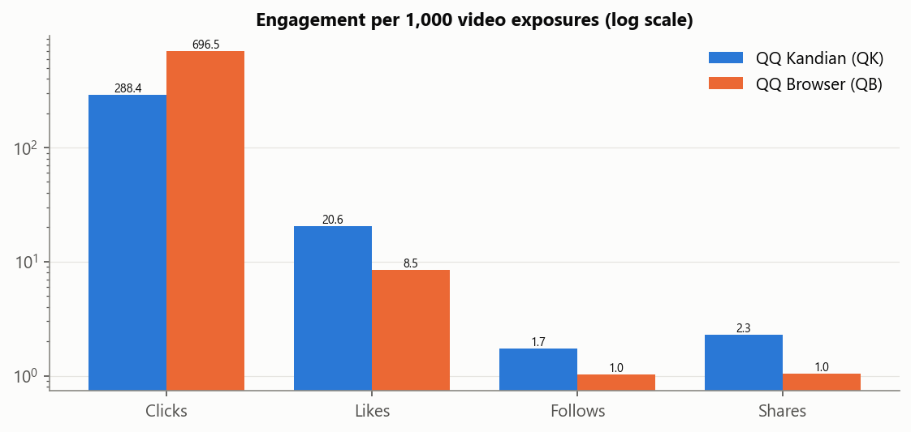
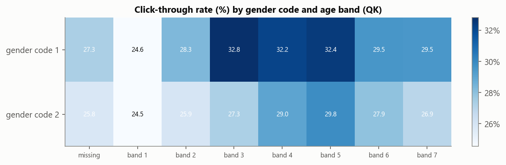
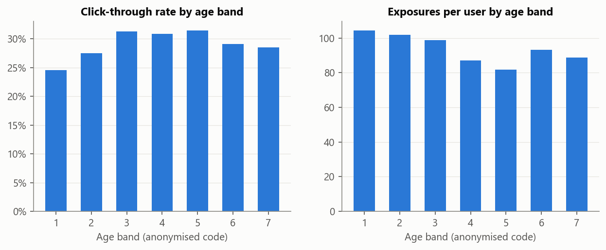
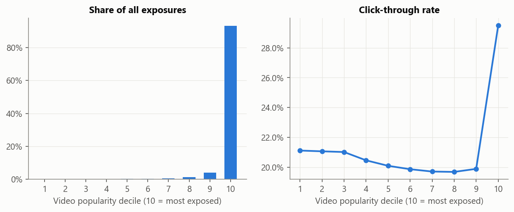
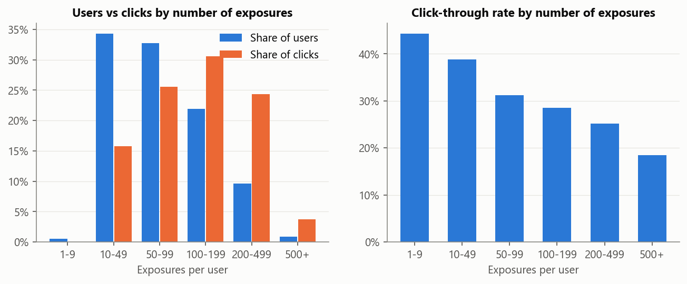
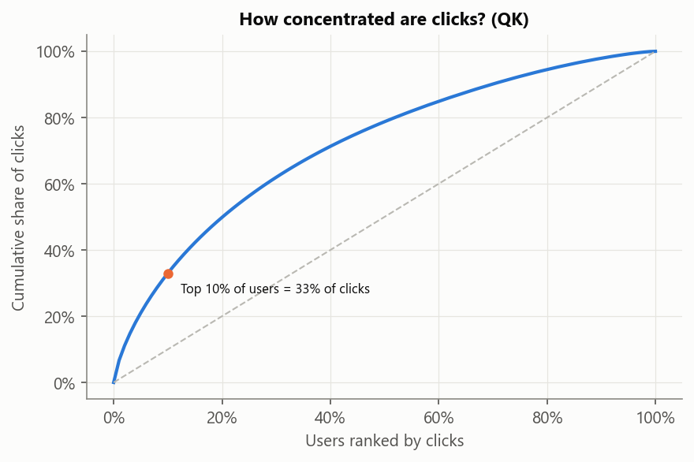
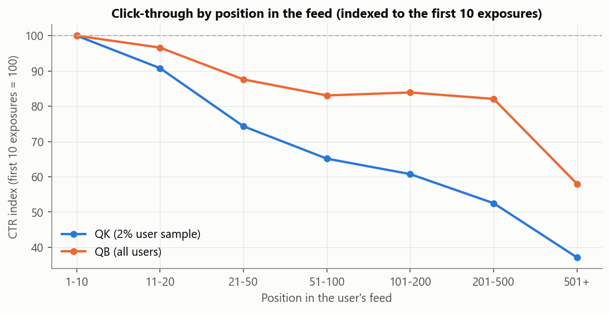

# Tencent Video Feed Engagement Analysis (Tenrec)

> Data: Tenrec benchmark (Tencent, NeurIPS 2022): Tenrec official release (real data)
> QQ Kandian (QK): 493,458,970 video exposures, 5,022,750 users, 3,753,436 videos.
> QQ Browser (QB): 2,442,299 exposures, 34,240 users, 130,637 videos.
> Each row is one exposure with click, like, share and follow flags. Gender and age are anonymised codes (0 = missing). No timestamps are provided.
> Data quality (QK): 182,123,455 rows have watching_times > 0 without a click, so watching_times is not used as a post-click metric; 5,750,034 rows have a like, share or follow without a click (kept as recorded). Exposures with a missing video_category are almost never clicked.
> Missing values (written as \N in the source): QK video_category 6,507,071, gender 0, age 0, click 0; flags default to 0, gender/age to code 0, video_category to "missing".

## 0. Executive summary

| Area | Key numbers | Interpretation |
|---|---|---|
| Click-through | QK 28.8% of exposures clicked; QB 69.7% | QB users click 2.4x as often but like 5.9x less per click: shallow clicking vs deeper engagement |
| Depth | Per 1,000 QK clicks: 71.3 likes, 6.0 follows, 7.9 shares | Only 32% of users ever liked and 9% ever followed |
| Popularity | Top 1% of videos get 66.1% of exposures; 1,302,376 videos were shown only once | Exposure is highly concentrated |
| Earned exposure | CTR of the most-exposed decile 29.5% vs deciles 5-9 19.8% | Popular videos click better, but this is partly a feedback loop: high CTR earns exposure and exposure builds popularity |
| Users | Top 10% of users make 33% of clicks; CTR falls from 44% for the lightest users to 18% for the heaviest | Engagement is driven by a minority |
| Fatigue | QK same users: 32.06% vs 24.32% (10,365 users) | QK click-through decays with scrolling depth; QB users who scroll far click more (different product behaviour) |
| Audience | CTR ranges from 24.6% (age band 1) to 31.4% (band 5) | Ranking should be calibrated by audience segment |

## 1. Engagement funnel

- QK: 493,458,970 exposures -> 142,321,193 clicks (28.8%) -> 10,141,195 likes, 857,679 follows, 1,128,312 shares.
- QB: 2,442,299 exposures -> 1,701,171 clicks (69.7%) -> 20,687 likes, 2,487 follows, 2,541 shares.
- CTR: QK vs QB (two-proportion z-test): 28.84% vs 69.65%, p = 0, z = -1402.
- Likes per click: QK vs QB (two-proportion z-test): 7.13% vs 1.22%, p = 0, z = 299.2.
- QB, video_category missing: CTR 18.8%, likes per 1k clicks 74.1 (0% of that platform's exposures)
- QB, video_category 0: CTR 67.8%, likes per 1k clicks 12.7 (40% of that platform's exposures)
- QB, video_category 1: CTR 70.9%, likes per 1k clicks 11.8 (60% of that platform's exposures)
- QK, video_category missing: CTR 0.4%, likes per 1k clicks 14.9 (1% of that platform's exposures)
- QK, video_category 0: CTR 29.4%, likes per 1k clicks 76.8 (58% of that platform's exposures)
- QK, video_category 1: CTR 29.0%, likes per 1k clicks 63.2 (41% of that platform's exposures)

## 2. Audience

- Gender code 1: 2,590,526 users, CTR 29.7%, 100 exposures per user
- Gender code 2: 1,283,740 users, CTR 26.6%, 97 exposures per user
- CTR differs by gender code (chi-square): code 1: 29.73% vs code 2: 26.62%, p = 0, chi2 = 398,920.
- Age band vs CTR (Spearman, across bands): 7 bands, p = 0.38, rho = 0.39.

## 3. Content and popularity bias

- 3,753,436 videos; the top 10% receive 93.2% of exposures and the top 1% receive 73.4% of clicks.
- Item exposure decile vs CTR (Spearman): 10 deciles, p = 0.28, rho = -0.38.
- Videos with 100-999 exposures: 306,643 videos, mean video CTR 21.8%
- Videos with 1k-10k exposures: 59,584 videos, mean video CTR 26.3%
- Videos with 10k-100k exposures: 7,518 videos, mean video CTR 32.2%
- Videos with 100k+ exposures: 168 videos, mean video CTR 39.1%

**Recommendation 1: test an exploration slot.** Popular videos click better, but exposure is extremely concentrated. Reserve a small exploration slot (for example 1 in 10 positions) so new videos can prove themselves, and measure CTR and catalogue coverage in an A/B test.

## 4. Users

- 5,022,750 users: 21 never clicked, 32.1% ever liked, 13.1% ever shared, 9.1% ever followed.
- 1-9 exposures: 0.5% of users, 0.0% of clicks, CTR 44.3%
- 10-49 exposures: 34.3% of users, 15.8% of clicks, CTR 38.9%
- 50-99 exposures: 32.7% of users, 25.5% of clicks, CTR 31.2%
- 100-199 exposures: 22.0% of users, 30.6% of clicks, CTR 28.5%
- 200-499 exposures: 9.6% of users, 24.3% of clicks, CTR 25.1%
- 500+ exposures: 0.9% of users, 3.7% of clicks, CTR 18.4%

**Recommendation 2: turn clickers into engaged users.** Almost every user clicks something (only 21 never did), but only 32.1% ever liked, 13.1% ever shared and 9.1% ever followed. Prompts such as a follow button after the second video from the same creator, measured by the share of users with a first follow within 7 days, target the larger gap.

## 5. Feed fatigue

- QB: same users' CTR, first 20 vs exposures 101-200 (Wilcoxon signed-rank, two-sided): 54.27% vs 64.89% (2,483 users), p = 2e-81, 31% of users click less later.
- QK: same users' CTR, first 20 vs exposures 101-200 (Wilcoxon signed-rank, two-sided): 32.06% vs 24.32% (10,365 users), p = 0, 67% of users click less later.
- In the QK sample, CTR is 38.8% in the first 20 exposures but 23.2% beyond exposure 100, and 31% of all exposures happen beyond position 100. This pooled gap mixes light and heavy users; the same-user test above confirms the drop within users. Scaled to all QK users, the gap is about **23.8M clicks**; recovering a tenth of it would add about **2.4M clicks** (+1.7%).

**Recommendation 3: refresh deep sessions.** Insert diversity breaks (new categories or creators) after about 100 exposures and A/B test the effect on CTR at depth and on total session clicks.

## 6. Limitations
1. No timestamps: position in the file is used as scroll order (the Tenrec authors build session sequences the same way), so fatigue mixes within-session and across-session effects.
2. Gender, age and video_category are anonymised codes; the analysis compares groups but cannot name them.
3. QK sequence analysis uses a fixed 2% user sample (user_id divisible by 50) to keep the sort affordable; totals elsewhere use all rows.
4. Observational data: every recommendation needs an A/B test.
